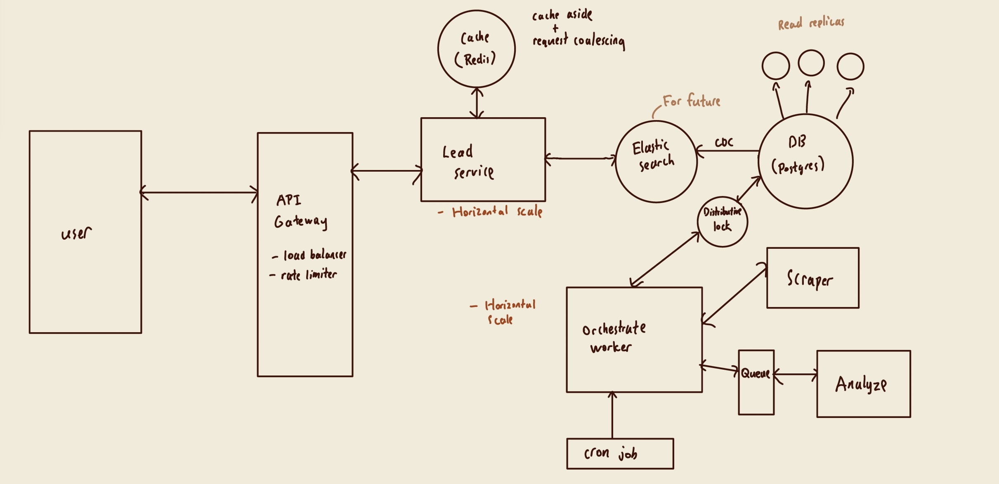
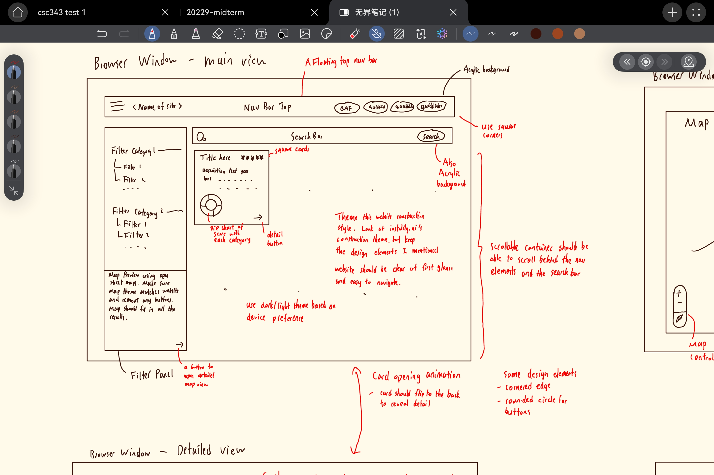
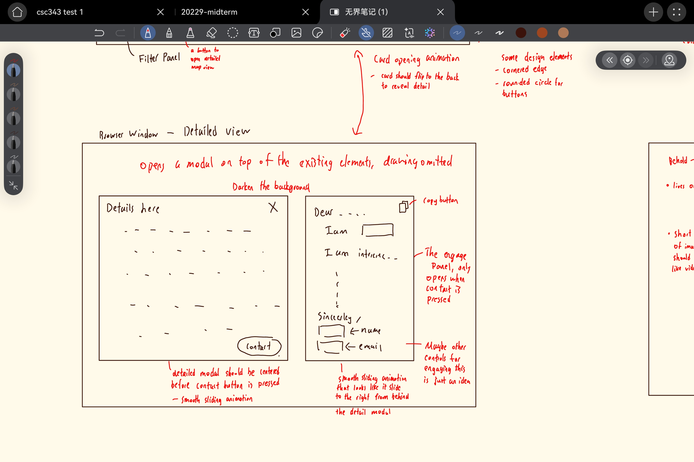
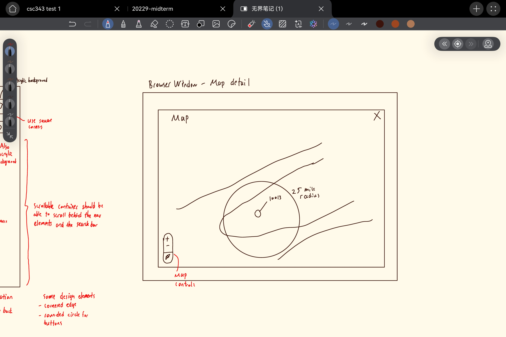
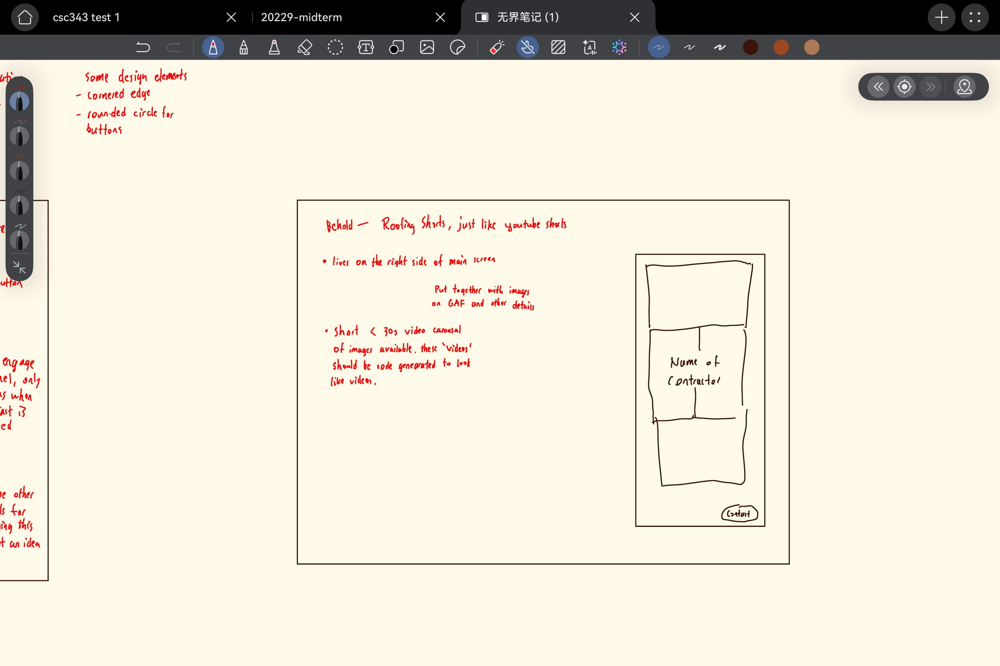

## Functional Requirements
- search with filters of leads
- view each leads detail and ai recommendation
- draft opening sentence

## Non-Functional Requirements
- scale to thousands of users
- availability > consistency
- low latency for searches
- read > write (write only happens when scraping, read is a lot more intensive)

## API endpoints
```
GET /v1/leads?page={page}&limit={limit}&filter....
GET /v1/map
GET /v1/leads/{gaf_id}
```

## High Level Design


## Details

### PostgresSQL
Used postgres since I am most familiar with it, and with our system, its speed and efficiency is sufficient. Read replicas will used to speed up reads since server expects a lot of them

### Lead service
Reads from cache first, on cache miss, query the database and build cache. To prevent cache stampede, implemented request coalescing by only allow 1 request to build cache, and others wait. Use redis for cache for fast reads under 1ms/query.

### Orchestrate Worker
controls data flow from scraping and analyze.
1. runs the GAF scraper
2. calculate the priority score from returned data
3. stores into database
4. add each contractor returned to analysis queue

- a distributive lock to prevent multiple orchestrate worker editing the same thing

### GAF Scraper
scrapes GAF website. Since GAF bot detection prevents us from scrapings its website directly even though ROBOTS.txt says scrapers can access the list of contractors. To respect website owner policies, I found that GAF uses COVEO to provide the search data for their website and used browser tools to capture the network request they sent. The scraper uses that request to get the data. But the limitation is we don't have the about me section of the company (see future improvement for solution)

### Analysis
Removes job from the queue and perform AI analysis based on the model selected in settings. For this I fine-tunned and quantized qwen 1.7b on ~1600 distilled data by a smarter model on Ollama, this offers cheap and fast model designed exactly for this use case without using costly api.
- FYI: 800 contractors analyzed by Haiku costed $3, my qwen 1.7b Q4_K_M (called lili-analyst) is practically free and really lightweight with result just as good. 207 tokens/s on RTX3070 (~1.5s per request)
- use a fingerprint on each job to make sure no tokens is spent on analyzing the same unchanged data
- reviews is sent as bands (none, 1-9, 10-49, etc) so analysis doesn't have to rerun just because 1 more review is added for popular contractors (not really gonna matter). Reduces cost

### Lead Scoring
Used 4 parts with 25 points each, total 100 point
1. Review count adjusted rating: 4.9 with 500 reviews is more credible than 5.0 with 10 reviews, so the formula is `adjusted = (rating x reviews + 4.0 x 100) / (reviews + 100)`; `points = 25 x clamp(adjusted - 4.0, 0, 1)`; no reviews = 0.
2. GAF rank: Certified 0, Certified Plus 5, Master Elite 10, plus President's Club (1 star +10, 2+ stars +15), capped at 25: GAF's tiers and award are the best public signs of size and quality.
3. Specialty: 25/3 points per product line beyond shingles (FORTIFIED, Metal, Solar, Single-Ply, Asphaltic, Coatings), full at 3.
4. Distance: use 1/x with some transformations. 1-5 mile is a big jump, but 20-25 mile is a smaller jump, so the 1/x curve and its asymptotic behaviour is a good choice `25 / (1 + miles / 25)`.

## Database Schemas
- scrape_runs(<u>id</u>, zip_code, status, started_at)
- contractors(<u>gaf_id</u>, name, rating, review_count, certification, president_club_stars, commercial_certification, services, phone, address, distance_miles, latitude, longitude, profile_url, logo_url, fingerprint, priority_score, review_count_adjusted_rating, gaf_rank, specialty, distance, updated_at)
- analyses(<u>gaf_id</u>, summary, why_good_lead, pitch, talking_points, draft_email, fingerprint)
- analysis_jobs(<u>gaf_id</u>, status, attempts, error, delay, updated_at)

## Frontend and UI





- Contractor Shorts: just like youtube short/tiktok/reels, let user scroll and view each contractor as a quick video content.
- website optimized for all size of screens

## Future Improvements (another 8 hours)
- rate limiter
- elasticsearch: supports geospatial search and faster search speed across multiple filters
- keyset pagination: If offsets gets slow on big lists
- CDN for the frontend and cached answers
- retrain lili-analyst (my fine tuned model) on more data to cover edge cases
- Paid or self hosted map server (OpenStreetMap allows light use only)
- Replicas, currently my device only have 1 SQL database, the code aready supports multiple replicas.
- Each analysis worker poll every 5 seconds to find new job, instead should use LISTEN/NOTIFY from PostgresSQL at scale
- Implement a "research" agent that searches each finding for more details to bypass the GAF block
